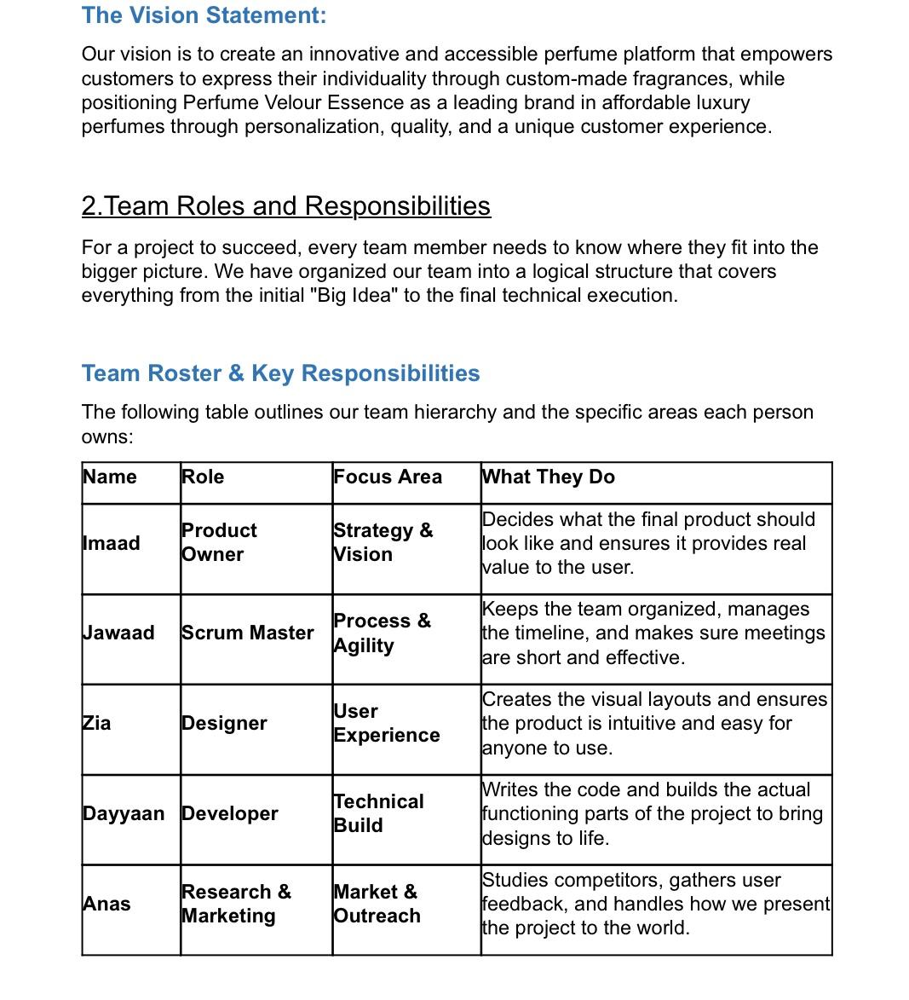
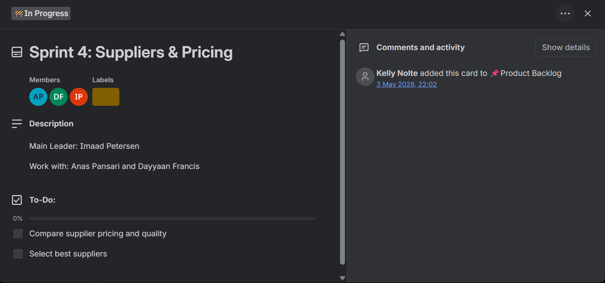
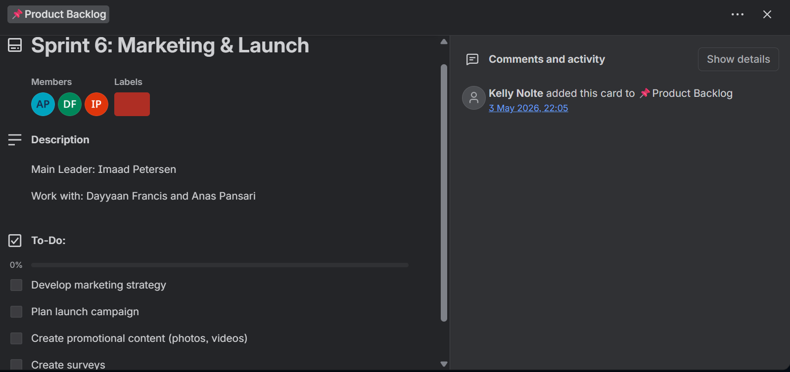
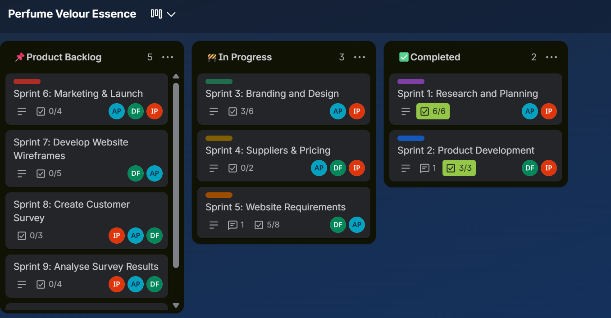
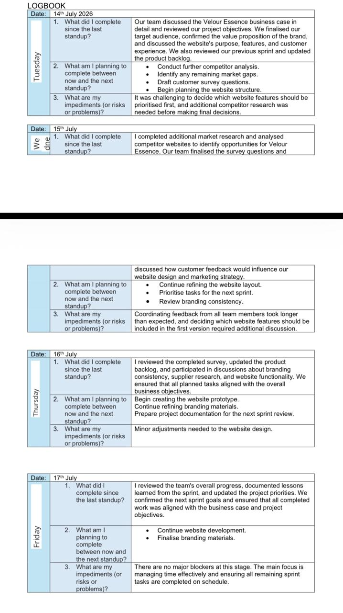

# IMAAD PETERSEN
**ICT Applications Development Student**

<i class="fa-solid fa-location-dot"></i> Cape Town, South Africa &nbsp;•&nbsp; <i class="fa-solid fa-envelope"></i> petersenimaad3@gmail.com &nbsp;•&nbsp; <i class="fa-solid fa-phone"></i> 068 061 8314

[<i class="fa-brands fa-linkedin"></i> **LinkedIn Profile**](https://www.linkedin.com/in/imaad-petersen-b02ab22aa) | [<i class="fa-solid fa-file-arrow-down"></i> **Download Full CV (PDF)**](Imaad_Petersen_CV%20(2).pdf)

---

## <i class="fa-solid fa-id-card"></i> Professional Summary
Motivated ICT (Applications Development) student seeking WIL placement to apply programming skills in PHP, JavaScript, HTML, CSS, Java. Eager to contribute to a development team while gaining practical experience. My core focus lies in solving complex problems through clean, efficient code and structured application design.

---

## <i class="fa-solid fa-layer-group"></i> Technical Stack

 
 
 
 
 
 
 

---

## <i class="fa-solid fa-video"></i> Mock Interview Video

  

    <video width="100%" controls style="border-radius: 6px; display: block;">
      <source src="MockInterviewVideoImaadPetersen.mp4" type="video/mp4">
      Your browser does not support the video tag.
    </video>
  

---

## <i class="fa-solid fa-graduation-cap"></i> Education

- **CPUT Diploma ICT: Applications Development** | *2023 – Present*
- **Livingstone High School** | *Matric Certificate | 2018 – 2022*

---

## <i class="fa-solid fa-briefcase"></i> Work Experience

### **SEASONAL CRICKET COACH** | Under the Sun Cricket Coaching
*Oct 2024 – Jan 2025*
- Planned practice sessions, developed player skills and team strategies.
- Assessed individual strengths for team selection.

### **SEASONAL CASHIER** | Howler Events
*June 2020 – May 2025*
- Processed sales, scanned items, verified armbands, handled payments.
- Provided friendly service in high-pressure environment.

### **EVENT STAFF** | R&S Catering
- Assisted with table setup and food arrangement.
- Provided courteous service to guests.

---

## <i class="fa-solid fa-address-book"></i> Professional References

- **Sazi** *(Events Manager, Howler Events)* — <i class="fa-solid fa-phone"></i> 071 489 9861
- **Patrick Van Niekerk** *(Head Coach, Under The Sun)* — <i class="fa-solid fa-phone"></i> 081 335 7696
- **Rijana Petersen** *(Owner, R&S Catering)* — <i class="fa-solid fa-phone"></i> 081 430 4801

---

## <i class="fa-solid fa-diagram-project"></i> Agile Project Management & Artifacts (Perfume Velour Essence)

Below are the core Agile management artifacts and documentation compiled during the development of our project, **Perfume Velour Essence**, developed collaboratively by Imaad Petersen (Product Owner), Anas Pansari, Dayyaan Francis, Zia Modarrisi, and M. Jawaad Allie.

### 1. Agile Team Charter

* **Description:** Establishes our team agreement, core project purpose, and individual responsibilities for the Velour Essence custom fragrance platform.
* **Team Roles:** Imaad Petersen (Product Owner/Leader), working closely with Anas Pansari, Dayyaan Francis, Zia Modarrisi, and M. Jawaad Allie.

> ### <i class="fa-solid fa-lightbulb"></i> Reflection: Agile Team Charter
> * **Situation:** To kick off our collaborative project successfully, our development team needed a unified framework outlining our working agreements, communication channels, and shared objectives.
> * **Task:** My objective as Product Owner was to establish a formal Team Charter that aligned all members around our project goals and individual responsibilities for *Perfume Velour Essence*.
> * **Action:** I collaborated with the team to define our core values, set expectations for sprint accountability, and document our operational rules.
> * **Result:** This charter eliminated ambiguity from day one, fostering a disciplined team culture that kept everyone focused throughout development.

---

### 2. User Stories and Tasks

* **Description:** High-level project requirements were broken down into formal Epics and granular Trello tasks with actionable checklists.
* **Formal Epics & User Stories:**
  * **Epic 1: Custom Scent Builder**[cite: 18, 19]
    * *"As a customer, I want to select scent notes and adjust intensity, so that I can build a fragrance that matches my taste."*[cite: 19]
    * *"As a customer, I want to see a live preview/summary of my custom blend, so that I know exactly what I'm ordering before I pay."*[cite: 19]
    * *"As a customer, I want the system to suggest complementary notes, so that I don't have to be a perfume expert to get a good blend."*[cite: 19]
  * **Epic 2: Label & Bottle Personalization**[cite: 19]
    * *"As a customer, I want to design a custom label with my own text/name, so that my bottle feels personal and giftable."*[cite: 19]
    * *"As a customer, I want to choose a bottle size (small/medium/large), so that I can pick what fits my budget and usage."*[cite: 19]
  * **Epic 3: Checkout & Payments**[cite: 19]
    * *"As a customer, I want to add my custom scent to a cart and check out securely, so that I can complete my purchase with confidence."*[cite: 19]
    * *"As a customer, I want to see the final price update as I customize, so that there are no surprises at checkout."*[cite: 19]
  * **Epic 4: Account & Order Tracking**[cite: 19]
    * *"As a customer, I want to create an account and log in, so that I can save my favorite blends and reorder easily."*[cite: 19]
    * *"As a customer, I want to track my order status and delivery, so that I know when my perfume will arrive."*[cite: 19]
  * **Epic 5: Admin & Operations**[cite: 19]
    * *"As an admin, I want to manage product stock (oils, bottles, boxes), so that I can avoid running out during peak demand."*[cite: 19]
    * *"As an admin, I want to view and export customer survey results, so that I can adjust pricing and scent offerings based on real feedback."*[cite: 19]
  * **Epic 6: Marketing & Engagement**[cite: 19]
    * *"As a customer, I want to share my custom bottle design on social media, so that I can show off my creation and bring friends to the brand."*[cite: 19]
    * *"As a marketing team member, I want to schedule and publish launch content, so that our campaign runs on time across channels."*[cite: 19]

> ### <i class="fa-solid fa-lightbulb"></i> Reflection: User Stories & Tasks
> * **Situation:** Delivering a complex web application featuring a custom scent builder, live preview, and secure checkout required precise functional requirements.
> * **Task:** My responsibility was to translate high-level system goals into standard Agile user stories and break them down into actionable task checklists on Trello.
> * **Action:** I structured user requirements using standard user story conventions and mapped them to developer checklists assigned across our team sprints.
> * **Result:** This practice ensured clear visibility into technical deliverables, bridging the gap between customer expectations and development execution.

---

### 3. Product Backlog

* **Description:** Represents our prioritized master list of project features, upcoming sprint objectives, and strategic product requirements managed on Trello (e.g., *Sprint 6: Marketing & Launch*).

> ### <i class="fa-solid fa-lightbulb"></i> Reflection: Product Backlog Management
> * **Situation:** Managing multiple concurrent development tracks for *Perfume Velour Essence* required a centralized and prioritized backlog to control scope.
> * **Task:** I needed to maintain a living Product Backlog that ordered upcoming features by business value and user demand.
> * **Action:** I continuously reviewed backlog items, prioritized marketing and technical milestones, and updated card statuses as project priorities shifted.
> * **Result:** Keeping an organized product backlog prevented scope creep and gave the team a clear roadmap of future requirements.

---

### 4. Sprint Backlog

* **Description:** Displays our active Trello board layout with workflow columns (*Product Backlog*, *In Progress*, and *Completed*), tracking active sprint tasks across team members.

> ### <i class="fa-solid fa-lightbulb"></i> Reflection: Sprint Backlog Execution
> * **Situation:** To ensure continuous delivery, we needed a transparent workspace to track task allocation and progress in real-time.
> * **Task:** My objective was to manage the Sprint Backlog columns effectively, ensuring team members were aligned on daily deliverables.
> * **Action:** I monitored task progression across board columns, updating sprint statuses and coordinating responsibilities between team members.
> * **Result:** Visualizing workflow states on our board improved team transparency and ensured our sprints were completed on schedule.

---

### 5. Agile Logbook

* **Description:** Formal logbook table capturing daily stand-up records, completed tasks, planned actions, and risk/impediment tracking across project sessions (July 14–17).

> ### <i class="fa-solid fa-lightbulb"></i> Reflection: Agile Logbook & Stand-ups
> * **Situation:** Accountability and risk tracking were critical to overcoming roadblocks during the design and planning phases.
> * **Task:** I needed to document daily stand-up outcomes, completed work, and team impediments consistently.
> * **Action:** I maintained our daily logbook entries, recording task updates, upcoming goals, and addressing blockers regarding feature prioritization.
> * **Result:** Regular logbook documentation reinforced team alignment and provided a clear historical record of our continuous progress.

---

## <i class="fa-solid fa-lightbulb"></i> Professional Reflections (STAR Method)

> ### <i class="fa-solid fa-code"></i> 1. Reflection on Coding in Markdown
> * **Situation:** To meet the requirements for my Digital Portfolio, I needed a way to present my professional background and technical skills using a lightweight markup language.
> * **Task:** My objective was to use GitHub Flavored Markdown (GFM) to create a clear, organized, and professional CV that effectively communicates my work-readiness.
> * **Action:** I applied Markdown syntax to structure headers, create a technical stack display, and organize my experience. I focused on making the document easy to read while ensuring all evidence was properly categorized.
> * **Result:** I successfully created a professional-level document as per the assessment rubric. This process enhanced my understanding of how developers use Markdown for professional documentation.

> ### <i class="fa-solid fa-microphone"></i> 2. Reflection on Mock Interview Experience
> * **Situation:** As part of the PRP370S assessment, I participated in a mock interview to simulate a professional recruitment process in the ICT industry.
> * **Task:** I needed to demonstrate my communication skills and technical knowledge on camera, then reflect on how this shows an evolution in learning.
> * **Action:** I prepared by reviewing my past projects and practiced articulating my problem-solving steps. During the recording, I focused on maintaining professional body language and providing structured technical explanations.
> * **Result:** Reviewing my performance allowed me to identify areas for improvement in my verbal delivery. This exercise bridged the gap between technical coding ability and the professional communication required for a career in development.

> ### <i class="fa-solid fa-globe"></i> 3. Reflection on Use of GitHub Pages
> * **Situation:** After designing my portfolio in Markdown, I needed to make the content publicly accessible to lecturers and potential employers.
> * **Task:** The goal was to deploy my repository to GitHub Pages to provide live evidence of my digital presence and deployment skills.
> * **Action:** I enabled GitHub Pages in my repository settings, ensuring my README.md was correctly targeted as the source. I verified that all multimedia elements, including my interview video and links, were functioning in the live environment.
> * **Result:** By publishing to my github.io domain, I gained practical experience in the steps of e-portfolio creation. Having a live URL demonstrates my ability to take a software project from development to production.
